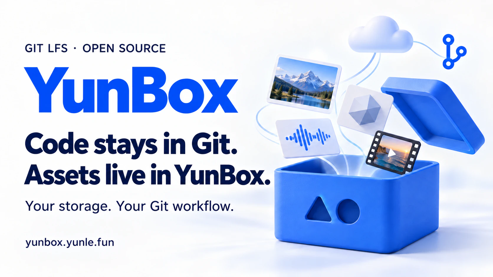

# YunBox

[简体中文](./README.md) · **English**



[](https://www.npmjs.com/package/yunbox)
[](https://github.com/YunLeFun/yunbox/releases/latest)
[](./LICENSE)

**Keep your Git workflow for games, design and media projects.** YunBox works with Git LFS: code stays on GitHub or your Git host, while assets go straight to your own Tencent Cloud COS, Cloudflare R2, AWS S3 or MinIO storage. Check Git and LFS sizes before a push and confirm before large files leave your machine.

[Website & demos](https://yunbox.yunle.fun/en/) · [Quick start](./docs/en/guide/index.md) · [Download the app](https://github.com/YunLeFun/yunbox/releases/latest) · [Changelog](./docs/en/changelog.md)

## What you can do

| Your workflow | What YunBox provides |
| --- | --- |
| Keep assets in your own storage | Direct COS and S3-compatible transfers with the familiar `git add`, `commit`, `push` and `clone` commands; no server to deploy |
| See what a push will upload | Separate Git pack and LFS budgets, oversized file lists, confirmation with a reason, and scheduled push freezes |
| Manage assets visually | A native macOS app with budgets, file changes, image comparisons, text diffs, storage setup and menu bar status |
| Put the right files in LFS | Rules for textures, design files, models, audio and more, with game, design and media presets |
| Work with a team | Shared repository settings without secrets, individual credentials, and `doctor` checks with repair suggestions |
| Use scripts and AI tools | A CLI for macOS, Linux and Windows, structured JSON reports, and readable reasons for push decisions |

### The app in action

<p>
  
  
</p>

*Actual screenshots of the Asset Types panel in Chinese. The app also has an English interface; the banner above is a promotional illustration. See the [macOS guide](./docs/en/guide/macos.md) for more features.*

## Quick start

### Install the CLI

You need **Node.js 22.18+ within 22.x, 24.11+ within 24.x, or 26+**, **Git 2.30+** and **Git LFS 3.2+**. Node.js 24 LTS is recommended. On Windows, use Git for Windows.

```bash
npm install -g yunbox
```

This installs both `yunbox` and `git-yunbox`; `git yunbox <command>` and `yunbox <command>` are equivalent. Use `yunbox --help` or `git yunbox help` for help: Git interprets `git yunbox --help` as a request for a man page. CLI messages are currently in Chinese; commands, options and JSON fields are the same in any language.

For a graphical interface, [download the macOS app](https://github.com/YunLeFun/yunbox/releases/latest), unzip it and move it to Applications. The app includes its CLI component and still requires Node.js, Git and Git LFS on your machine. Install the npm package above to use YunBox directly in a terminal.

> **Version note:** Starting with 0.1.6, the app requires macOS 26+, is notarized by Apple and includes automatic updates. On macOS 14 / 15, use [0.1.5](https://github.com/YunLeFun/yunbox/releases/tag/v0.1.5). CLI platform support is unchanged. See the [changelog](./docs/en/changelog.md) for release details.

### Try push inspection first

Run these commands in an existing Git repository. No cloud storage setup is required:

```bash
yunbox inspect --push           # Inspect the Git / LFS data ready to push
yunbox hook install --confirm   # Protect this repository; ask when over budget
```

The check runs before the repository's existing pre-push hook and LFS upload. On macOS it can show a confirmation dialog, even when the YunBox app is closed. If nobody confirms, the push is cancelled. Default budgets are **900 KiB** for the Git pack, **100 MiB** for LFS and **10 MiB** per file. These are configurable push thresholds.

```bash
yunbox inspect --push --json       # Structured output for scripts and tools
yunbox freeze set "Mo-Fr 09:00-18:00" # Optional: block pushes during working hours
```

Pushes are blocked during a freeze window. See [push inspection](./docs/en/inspect.md) and [push freezes](./docs/en/guide/freeze.md) for options, budgets and confirmation behavior.

### Connect your own asset storage

In direct mode, the transfer agent signs requests locally and moves assets between your computer and object storage:

```text
Code and LFS pointers ── git push / clone ──▶ GitHub or your Git host
Asset contents       ── git-lfs ──▶ YunBox transfer agent ──▶ your COS / S3 storage
```

**Tencent Cloud COS:** An admin installs and signs in with the [Tencent Cloud CLI](https://github.com/TencentCloud/tencentcloud-cli), then connects an existing Git repository:

```bash
tccli auth login
git yunbox init                 # Pick or create a private bucket; check access
yunbox subaccount create --save  # Create a restricted long-term key and save it locally
git add .gitattributes .yunbox/config
git commit -m "chore: store LFS assets with YunBox"
git push
```

**Cloudflare R2, AWS S3 or MinIO:** Create a private bucket and access keys with your provider first, then run:

```bash
yunbox login --provider s3
git yunbox init --preset r2      # Or aws / minio; follow the storage setup prompts
```

Commit `.gitattributes` and `.yunbox/config` after setup. Follow the [COS quick start](./docs/en/guide/index.md) or [R2 / S3 guide](./docs/en/guide/r2.md) for the complete walkthrough. For assets already stored in GitHub LFS, follow the [migration guide](./docs/en/guide/migrate.md) to transfer historical objects first.

**Joining a team:** Get your own storage credentials from an admin, then sign in and clone:

```bash
yunbox login                     # Add --provider s3 for S3-compatible storage
git yunbox clone <repository-url>
yunbox doctor
```

See the [collaborator guide](./docs/en/guide/collaborators.md). Each clone needs its own local transfer-agent registration. After a regular `git clone`, run `git yunbox init` followed by `git lfs pull`.

### Onboarding and default protection

Starting with 0.1.6:

- On first launch, the app checks your environment, lets you select a repository, sets up push protection, and optionally connects storage. Reopen the guide from Help or Settings.
- `git yunbox init` offers to install the repository's push hook, asking before over-budget pushes by default. Existing protection settings are preserved; use `--no-hook` to skip installation.
- Global protection is optional: select “Apply to all repositories on this Mac” in the guide, or run `yunbox hook install --global`. Remove it with `yunbox hook uninstall --global`; check effective settings with `yunbox hook status`.
- Global installation preserves existing repository hooks and stops if another global hook manager is configured. A repository's own `core.hooksPath` can override the global setting; the guide shows whether protection actually applies.

## Useful commands

| Command | Purpose |
| --- | --- |
| `yunbox doctor` | Check settings, credentials, the transfer agent and storage permissions, with repair suggestions |
| `yunbox status --all` | Report LFS usage across branches and history without network access |
| `git yunbox types` | List asset types, LFS rules and files stored outside LFS |
| `git yunbox types add model,audio` | Add LFS rules for those asset types |
| `git yunbox types add archive --renormalize` | Stage matching files as LFS for the next commit; existing history is unchanged |
| `git yunbox types remove video` | Remove YunBox-generated video rules, keeping hand-written rules |
| `yunbox freeze off --for 1h` | Pause push freezes for one hour, then resume automatically |

## Storage and collaboration

- **Share settings; keep keys local.** `.yunbox/config` contains only storage locations. macOS prefers the login Keychain; a local credentials file is used when it is unavailable and on Linux and Windows. Give each collaborator their own least-privilege key.
- **Assets are content-addressed.** Identical content reuses the same object. Downloads are checked for size and SHA-256.
- **Direct mode has no file locking.** Coordinate edits to binary assets so multiple people do not change the same file at once.
- **Server mode is also available.** Deploy the [server](./docs/en/deploy.md) to issue and revoke personal tokens centrally. With COS object storage, assets still transfer directly to COS.

## Documentation

| Continue here | Topics |
| --- | --- |
| [Quick start](./docs/en/guide/index.md) / [Joining a team](./docs/en/guide/collaborators.md) | COS setup, sub-accounts and collaboration |
| [R2 and S3](./docs/en/guide/r2.md) / [Migrate existing LFS assets](./docs/en/guide/migrate.md) | Storage options and historical assets |
| [Push inspection](./docs/en/inspect.md) / [Push freezes](./docs/en/guide/freeze.md) | Budgets, confirmation and schedules |
| [macOS app](./docs/en/guide/macos.md) / [AI-assisted setup](./docs/en/guide/ai.md) | Graphical interface and AI workflows |
| [FAQ](./docs/en/guide/faq.md) / [Changelog](./docs/en/changelog.md) | Common questions and release notes |
| [Promotional assets](./assets/readme/README.md) | Chinese and English banners, usage and generation prompts |

## Development

Use Node.js 24 as specified in `.node-version` and the pnpm version in `package.json`:

```bash
pnpm install
pnpm build
pnpm lint
pnpm typecheck
pnpm test

pnpm docs:dev
pnpm docs:build
```

| Directory | Contents |
| --- | --- |
| `packages/core` | LFS protocol types, input validation and storage interfaces |
| `packages/cli` | `yunbox` / `git-yunbox` commands and built-in storage providers |
| `packages/server` | Batch, Verify, object transfer and metadata services |
| `apps/macos` | SwiftUI app sharing the CLI's inspection logic |
| `docs` | Bilingual VitePress website and documentation |

CLI tests live in `packages/cli/test/`; server end-to-end tests using real Git and git-lfs live in `packages/server/test/`. Default tests use isolated temporary directories and local test doubles, with no cloud credentials required. Live cloud tests are opt-in; see the [deployment guide](./docs/deploy.md) (Chinese). Direct storage providers are built in; extension conventions are in the [storage development notes](./packages/cli/src/storage/README.md) (Chinese).

Building the macOS app requires Xcode 27.1 with the macOS 27.0 SDK. Run `./script/build_and_run.sh --install` to install it at `~/Applications/YunBox.app`. See the [app README](./apps/macos/README.md) (Chinese) for packaging, signing and automatic updates.

<details>
<summary>Local server, administration and releases</summary>

### Run a local server

From the repository root, create a token and start the server. The plaintext token is shown only once, at creation:

```bash
pnpm --filter @yunbox/server start token create --name alice --write demo/assets --storage-dir .yunbox-data
pnpm --filter @yunbox/server start --port 8080 --storage-dir .yunbox-data
```

In another terminal, connect a test Git repository. Enter the token when prompted and save it with your Git credential helper:

```bash
git yunbox init --url http://127.0.0.1:8080/demo/assets
git add .gitattributes .lfsconfig
git commit -m "chore: configure YunBox LFS"
yunbox doctor
```

The server listens only on `127.0.0.1:8080` by default; `GET /_health` provides a health check. This is a local development configuration. Listening on another address requires an HTTPS `--public-url`. Configure storage, metadata and access controls for production following the [deployment guide](./docs/deploy.md) (Chinese).

### Manage tokens and grants

Administration commands must use the same storage and metadata configuration as the server. These examples reuse `.yunbox-data` from above:

```bash
pnpm --filter @yunbox/server start token list --storage-dir .yunbox-data
pnpm --filter @yunbox/server start token revoke alice --storage-dir .yunbox-data
pnpm --filter @yunbox/server start grant list --storage-dir .yunbox-data
pnpm --filter @yunbox/server start grant set alice --write 'team/assets' --read 'team/*' --storage-dir .yunbox-data
```

Tokens expire after 90 days by default; adjust this with `token create --expires-in 30d`. `grant set` replaces the user's grants. Server caches and already-issued COS URLs mean revocation takes up to five minutes to become fully effective. Use `token migrate` for legacy `tokens.json` data; see the [deployment guide](./docs/deploy.md) (Chinese).

### Configure storage with `cos setup`

Server mode can route repositories to different buckets or prefixes:

```bash
pnpm --filter @yunbox/server start cos setup
pnpm --filter @yunbox/server start cos routes
pnpm --filter @yunbox/server start cos check
pnpm --filter @yunbox/server start --storage cos --storage-config yunbox.storage.json
```

The configuration file contains routes, with no keys. Runtime COS credentials and CloudBase metadata settings are covered in the [deployment guide](./docs/deploy.md) (Chinese).

### Releases (maintainers)

Update both changelogs, then run `pnpm release`: it changes the version, commits, tags and pushes. The Release workflow runs checks, publishes the CLI through npm trusted publishing, and builds and signs macOS updates. See the [workflows](./.github/workflows/) and [app README](./apps/macos/README.md) (Chinese) for website deployment and update notes.

</details>

## License

[MIT](./LICENSE) · [YunLeFun](https://github.com/YunLeFun)
