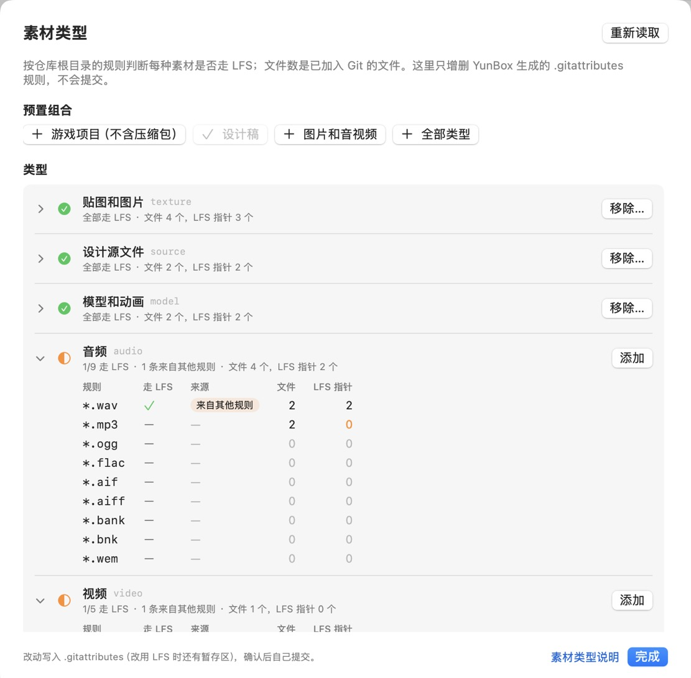
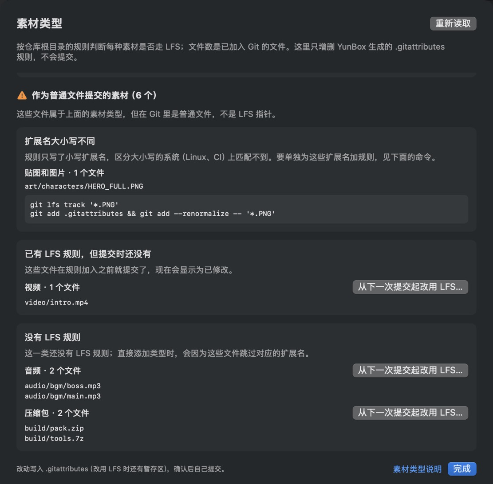

# macOS 客户端

一个原生的 SwiftUI 小工具，调用应用内附带的 YunBox 命令行，复用同一套 Git/LFS 检查。

## 安装

从[官网下载](/#download)最新的 `YunBox-macOS.zip`，解压后把 YunBox 拖进「应用程序」。需要 macOS 14 或更新，以及本机的 Node.js 22.18+。

::: warning 第一次打开
目前的安装包还没有经过 Apple 公证。第一次打开如果提示无法验证开发者，到「系统设置 → 隐私与安全性」点「仍要打开」，或者在终端运行：

```bash
xattr -dr com.apple.quarantine /Applications/YunBox.app
```

只有第一次需要这样做：之后的版本由客户端自动更新，不会再提示。
:::

也可以从源码构建，需要 Xcode 或包含 Swift 6 的开发工具：

```bash
pnpm install
./script/build_and_run.sh --install   # 安装到 ~/Applications/YunBox.app 并打开
```

## 自动更新

客户端内置自动更新（[Sparkle](https://sparkle-project.org)）：每天在后台检查一次，有新版本时显示更新说明，点「安装更新」后自动下载、替换并重新打开。也可以从「云匣 YunBox → 检查更新…」随时检查，或在「设置 → 软件更新」里关闭自动检查、改为自动下载并安装。

更新包和更新说明都经过签名，客户端只安装签名与内置公钥一致的版本。0.1.4 及更早的版本还没有这个功能，需要[手动下载](/#download)一次。每个版本改了什么见[更新日志](../changelog)，「帮助」菜单和「设置 → 软件更新」里也能打开。

## 界面语言

客户端有简体中文和英文界面，默认跟随系统。在「设置 → 语言」里可以单独选择，重新打开后生效；也可以在「系统设置 → 通用 → 语言与地区 → 应用程序」里设置，两处是同一个设置。更新提示里的说明也按界面语言显示。命令行输出的说明（例如 `yunbox doctor` 的检查项）目前只有中文，官网文档除更新日志外也只有中文。

## 能做什么

- **推送体积**：选择或拖入 Git 仓库，分别显示 Git pack 估算和 LFS 候选量、预算和超限状态；直连 COS 的仓库显示 LFS 实际需要上传的量，已在 COS 上的文件标为「已在 COS」。文件按大小降序，支持搜索、类型筛选、只看超限。
- **文件明细**：选中文件查看推送前后的变化：图片可以并排、拖动分隔线或来回切换对比，文本显示差异，可以切换统一视图或左右分栏，其他文件可用「快速查看」打开前后两个版本。内容取自推送的提交，而不是工作区。也可以复制路径或在 Finder 中定位。
- **COS 直连状态**：仓库标题右侧显示「直连 COS · 正常」「需要处理」或「未接入 COS」。点开逐项列出 `yunbox doctor` 的结果和修复命令。
- **交给 AI 接入**：COS 面板里的「复制给 AI 的接入说明」生成一段提示词，粘贴给编程助手即可按步骤接入，见[用 AI 编程助手接入](./ai)。
- **一键接入**：没接入的仓库可以在面板里选择已有 bucket 或新建私有 bucket、填写目录前缀，直接运行 `git yunbox init`；本机没有密钥时也可以在面板里保存子账号密钥。
- **菜单栏的禁推状态**：菜单栏显示云匣标志，当前仓库处在[禁推时段](./freeze)时右上角多一个圆点。点开面板查看能否推送、今天的时间轴和未来 7 天的禁推分布；全局规则（本机所有仓库）和每个项目的规则分开列出，都可以勾选「工作时间」「周末」等预设（项目没装 pre-push 包装层时会顺带安装），项目可以「设为当前」，不在列表里的用「添加项目…」选择，或打开「编辑禁推时段…」自定义；没装 pre-push 包装层时可以直接安装。标题栏的开关可以一键关闭全部禁推时段（规则保留），也能定时关闭 30 分钟、1 小时或到今天结束，到点自动恢复。
- **素材类型**：仓库标题右侧的「素材类型」按类型查看和调整 LFS 规则，见下面的[素材类型](#素材类型)。
- **最近的仓库**：最多 12 个，前 9 个用 `⌘1`–`⌘9` 切换。切换时先显示上次的检查结果，后台重新检查完成后替换。
- **最近被拦截**：pre-push 包装层（`yunbox hook install`）因为[禁推时段](./freeze)、超出预算或你在确认框里点了「取消」而拦下推送时，会在本机记下这个仓库；侧边栏顶部的「最近被拦截」列出最近 14 天里的最多 5 个，显示原因和时间，鼠标悬停可以看到具体是哪个时段或哪项预算。点一下即可打开检查，右键「从列表隐藏」，下次再被拦截时重新出现。记录只保存在本机的 `~/.config/yunbox/blocked-pushes.json`，只包含仓库路径、时间和原因，不含远端地址或密钥，也不会写进仓库。命令行设置了 `YUNBOX_CONFIG_DIR` 或 `XDG_CONFIG_HOME` 时记录会写到那个目录，而从程序坞或 Finder 打开的客户端读不到终端里的环境变量，这时列表为空。

## 素材类型

仓库标题右侧显示「素材类型 · 5/7 走 LFS」；有素材作为普通文件提交过时变成橙色的「素材类型 · N 个未走 LFS」。点开（或「检查 → 素材类型…」）就是图形界面版的 `git yunbox types`：

- **类型**：贴图和图片、设计源文件、模型和动画、音频、视频、字体、压缩包，各自显示全部走 LFS、部分走 LFS 或未走 LFS，以及已加入 Git 的文件数和其中的 LFS 指针数。展开可以看到每个扩展名是否走 LFS。手写或 `git lfs track` 加的规则标成「来自其他规则」，客户端不会删除它们。
- **添加和移除**：「添加」追加这一类的规则（`git yunbox types add`），「移除…」确认后删除 YunBox 生成的规则（`git yunbox types remove`）；已经存为 LFS 指针的文件不会改动。上方的预置组合（游戏项目、设计稿、图片和音视频、全部类型）一键添加多个类型，已经全部走 LFS 的组合显示为勾选。
- **作为普通文件提交的素材**：按原因分组列出：扩展名大小写不同（例如 Linux 上的 `HERO.PNG`）、已有规则但提交时还没有、没有规则。后两种可以点「从下一次提交起改用 LFS…」，确认后运行 `git yunbox types add <类型> --renormalize`：加上规则，并把 `.gitattributes` 和这些文件当前的内容加入暂存区，下一次提交起存为 LFS 指针。已有的提交（历史）不变。大小写不同的扩展名需要单独加规则，面板里给出对应的命令。

所有改动只写入 `.gitattributes` 和暂存区，不会提交；命令的输出显示在面板底部，确认后自己提交。

<p>
  
  
</p>

左：面板顶部的预置组合和类型列表，音频的 `*.wav` 来自手写规则；右：滚动到下方的「作为普通文件提交的素材」。

## 文档入口

「帮助」菜单可以直接打开官网文档。菜单栏面板的「使用说明」打开[禁推时段](./freeze)，编辑窗口和 COS 面板里也有对应说明的链接。

## 快捷键

| 快捷键 | 作用 |
| --- | --- |
| `⌘O` | 选择仓库 |
| `⌘1`–`⌘9` | 切换最近的仓库 |
| `⌘R` | 重新检查 |
| `⌘.` | 取消检查 |
| `⇧⌘C` | 复制完整 JSON |
| `⌘,` | 打开设置 |

窗口里的检查与实际 pre-push 收到的引用范围可能不同，最终推送仍由[推送检查钩子](../inspect)按实际引用重新检查。更多细节见 [客户端 README](../../apps/macos/README.md)。
